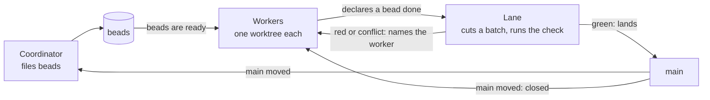

<p align="center">
  
</p>

Multi-agent accountability and verification system. Lighter than air.

## Philosophy

Do less.

Most agentic systems try to do too much. They end up in the way of models that keep getting
better at the work.

The models know how to do the work. Air gives them the facts they lack and stays out of the
rest.

Our goals are practical:

- Turn objectives into tasks that are as isolated as possible, so several agents can work at
  once.
- Give you one agent, the coordinator, as an uncluttered interface for development.
- Make it easy to start several harnesses, a fleet, each with one role.
- Offer a merge queue on plain git principles, so conflicts are rare and work keeps landing.
- Keep the fleet running through limit resets, interruptions and crashes.

## The roles

A fleet is three kinds of sessions. Each is a full Claude Code harness with one job.

**The coordinator** (`air coordinator`) is the session you talk to. It writes no code, so it
stays free to think and to answer you. It is the only session that turns goals into
[beads](https://github.com/gastownhall/beads), splitting large work into small beads with the
[decomposition skill](.claude/skills/decomposition/SKILL.md) and setting their priority. A
decision that is yours to make becomes a bead labelled `owner`, and workers never pick those
up. Through the coordinator you start, stop and resume the fleet.

**The workers** (`air worker`) each take one bead at a time in a git worktree of their own, so
no two workers edit the same checkout. There are three by default, and more than three gains
little on one machine. Every commit names its bead, so Air knows what each branch holds. A
worker declares its bead done as soon as the work is committed, and under a lane it runs no
full check of its own. A worker takes a lease on anything only one agent may use at a time,
such as a port or a simulator.

**The verification lane** (`air lane`) is the merge queue, and the only session that changes
`main`. It merges every ready branch into one batch and runs your check once for the whole
batch, which costs far less than testing each branch alone as a test suite grows. If the check
passes, the batch lands, so `main` only ever holds work that passed. If it fails, nothing
lands, and the lane verifies each member alone to find the one that broke it. A branch that
conflicts with another is left out, and its worker is told.

Your project defines the check: one command that exits 0 when the project is good, such as
`make verify`. If `.claude/air.json` names a `base_branch`, that branch plays the part of
`main` throughout.

### What Air tells each role

Nobody polls and nobody relays. Air delivers these facts into each session as they happen.

- The coordinator hears when a worker is stuck or gone, when a worker is blocked and has left
  it a note, and when work is ready to land. Where `heartbeat_minutes` is set, it also checks
  in on that interval, so it carries on after a pause or an account limit.
- A worker hears when beads are ready to claim, and the first claim wins. It hears when its
  batch went red, when its branch was dropped for a conflict, when `main` moved and which of
  its beads that landing closed, and when another worker is editing a file it has open.
- The lane hears when a branch is ready to cut.

The full list, and what each message asks of its reader, is in
[docs/rules/roles.md](docs/rules/roles.md).

## How it works



Air sends the messages on the arrows.

Sessions can still message each other directly, and sometimes that is the right way to
coordinate. Air's aim is to make it rarely necessary, so the fleet spends its time on the work.

## Install

Air needs git, tmux, Claude Code,
[beads](https://github.com/gastownhall/beads/releases/tag/v1.3.0) (`bd` 1.3.0) and, for a new
project, [Dolt](https://github.com/dolthub/dolt/releases/tag/v2.3.5) 2.3.5. Homebrew only has
the latest of each, so install these versions from their releases.

```sh
curl --proto '=https' --tlsv1.2 -LsSf \
  https://github.com/AJTJ/airunner/releases/latest/download/air-installer.sh | sh
cd /path/to/your/repo
air init --write
```

The installer puts a prebuilt `air` for macOS or Linux in `~/.cargo/bin`. The binaries are also
on the [releases page](https://github.com/AJTJ/airunner/releases), and
`cargo install --path crates/cli` builds one from a checkout.

`air init` looks for your check: a Makefile `verify` or `test` target, `cargo test`, or
`npm test`. It then prints the next steps: commit, record one green with
`air record verify -- <your check>`, and run `air coordinator`. If it finds no check, it
writes a `make verify` that fails until you fill it in.

If agents share a port or a device, list the commands that use it under `leases` in
`.claude/air.json`.

[examples/minimal](examples/minimal) is a three-file project after `air init`. It shows a check
and every file Air adds.

## Use

```sh
air coordinator
```

Say yes to starting the fleet. Air creates the worktrees, starts the beads server and opens a
tmux session per role.

Two prompts are not Air's to answer. Claude Code has to have been trusted in the main checkout
once, and the launcher refuses, naming the fix, until it has. Each new session also asks
whether to load the Air channel. The coordinator offers to answer that for you, or you accept
it in each pane.

Then tell the coordinator what to build. It runs everything from there.

You rarely need these, but they are there:

- `air fleet stop` and `air fleet resume` pause and resume all work.
- `tmux attach -t <project>-worker-1` lets you watch or type into any session.

To watch the fleet in a browser, run `air ui` in the main checkout and open the URL it prints.
The page is read-only and answers on 127.0.0.1 only.

## The pieces

Air is one Rust binary, `air`, plus the files it keeps in `.air/`.

- **Launchers.** `air coordinator`, `air worker` and `air lane` start sessions in their
  worktrees.
- **Ledger.** One SQLite file with claims, verification runs, leases and landings, plus a daily
  event log.
- **Hook.** `air hook` records every tool call, warns when two workers edit one file, and nudges
  an idle worker toward ready beads.
- **Done.** `air done` declares a bead done with proof, and refuses when no commit names the
  bead. The landing closes it.
- **Channel.** `air mcp` delivers Air's messages into each session and tells the coordinator
  when something needs attention.
- **Merge queue.** `air record`, `air batch cut` and `air land`. `air ready` offers the
  coordinator's own branch to the lane.
- **Remote runner.** `air run -- <command>` runs a command on the machine `targets` names for
  the session, pushing the branch there first. `air record` runs the check there the same way,
  and `--pull` brings result files back.
- **Live view.** `air ui` serves a read-only page of the fleet on loopback: the sessions and
  what each is doing, the board, the lane, what needs attention, and Air's decisions as a feed.
- **Diagnostics.**
  - `air status` shows the whole fleet on one screen.
  - `air audit` shows how often each rule fired, so rules that never fire can be removed.
  - `air doctor` checks the install and the pinned bd and Dolt versions.
  - `air selftest` proves every check can fail and pass.

## Upcoming

- Support for [Pi](https://github.com/earendil-works/pi) and other open-source harnesses.
- Sessions on other machines. Today every session is local, and only its commands and checks
  can run elsewhere, through `air run` and `air record` on a target reached by ssh or a command
  prefix such as `kubectl exec`.

## Inspired by

- [Gas Town](https://github.com/gastownhall/gastown): the batch-then-bisect merge queue, and
  checking a heartbeat against the real process.
- [beads](https://github.com/gastownhall/beads): the task store Air works beside.
- [Symphony](https://github.com/openai/symphony): isolated runs per piece of work.
- [bors-ng](https://github.com/bors-ng/bors-ng), [homu](https://github.com/rust-lang/homu) and
  [Zuul](https://opendev.org/zuul/zuul): merge queues that keep `main` on a tested tree.
- [Overstory](https://github.com/jayminwest/overstory): multi-agent orchestration with a merge
  step.
- [awesome-agent-orchestrators](https://github.com/andyrewlee/awesome-agent-orchestrators): the
  list Air was checked against.
- [Metis](https://github.com/colliery-io/metis): how to break work into epics and beads.

## How Air is tested

`make verify` runs the formatter, clippy, the tests and then `air selftest`. The self-test
is one probe per check Air makes, each shown firing on the failure and passing without it
([crates/cli/src/cmd/selftest.rs](crates/cli/src/cmd/selftest.rs)).

Before a release, a real fleet runs the [live trial](docs/design.md#91-the-live-trial). A
coordinator, a lane and three workers work through eleven scenarios on a copy of
[examples/minimal](examples/minimal), from a fixed [request](scripts/trial/request.md). The
coordinator writes a report of what happened, including every workaround, and
[scripts/trial/count.py](scripts/trial/count.py) counts the messages and refusals the run
needed.

## Docs

- [Design](docs/design.md): the whole system as it is today, kept current with the code.
- [Roles](docs/rules/roles.md): what each role does, shipped to adopters as `.air/roles.md`.
- [Adopting Air](docs/rules/adopting-air.md): install, configure and upgrade Air in a repo.
- [Verifying on another machine](docs/rules/remote-verify.md): a `targets` entry, from the
  first entry to the first green.

## Status

In use on two repositories. Commands still change between releases, and `air install` tells
an installed repository what changed.

## License

Apache-2.0. See [LICENSE](LICENSE).
