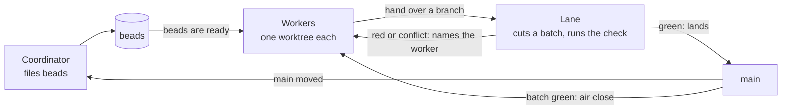

<p align="center">
  
</p>

Multi-agent accountability and verification system. Lighter than air.

## Philosophy

Do less. 

Most agentic systems try to do too much and end up interfering with a constantly evolving AI.

The models know how to do the work and they keep getting better at it.

Our goals are practical: 
- Offer a framework for transforming objectives into tasks that are as isolated as possible to facilitate concurrent work.
- Provide the user one harness (the coordinator) as a less cluttered interface for development.
- Ease the process of spinning up multiple harnesses (a fleet) to do get the tasks done.
- Design a simple merge queue, following git principles to avoid merge conflicts, and facilitate continued development.
- Help keep the fleet running through limit resets, interruptions, crashes etc...

## The roles

A fleet is three kinds of sessions. Each session is a full Claude Code harness (support for other harnesses incoming), and each has one job.

- **Coordinator** (`air coordinator`)
  - The coordinator is intended to be your interface. It does not write code itself and intends to remain uncluttered and free to talk to you.
  - It is the only harness that turns goals and tasks into [beads](https://github.com/gastownhall/beads). It splits largeer work into smaller beads with the [decomposition skill](.claude/skills/decomposition/SKILL.md), and sets their priority.
  - Through the coordinator you can control the fleet by starting and pauseing the workers and the verification lane.
  - Air informs the coordinator when a worker is stuck or has gone away, and when work is ready to land.
  - When a worker is blocked or uncertain, it sends the coordinator a note to its inbox.
  - If a decision requires your input, the coordinator files "owner" beads for you to go through. The workers do NOT pick these beads up.
  - There is an intermittent check-in clock every five minutes (by default), so it carries on after a pause or when hitting an account limit etc...
- **Workers** (`air worker`)
  - A worker works on one bead at a time through its own git worktree, so workers never edit each other's files.
  - There are three workers by default. Practically, adding more than three offers little benefit on a regular machine.
  - Air reports to workers when a bead is ready to be claimed. The first worker to claim it gets it.
  - Every commit names its bead, so Air knows what each branch contains.
  - Generally, a worker does not run the full test suite. It can run localized tests and picks up new work while the lane ensures a fell test run and verification of system integrity through the `verify` process.
  - Air tells a worker when its work passes, fails or lands, and when it clashes with another worker's work. Only on a pass will the worker close its own bead.
  - Air warns a worker when another worker is editing the same file to reduce conflicts.
  - A lease system exists to share system resources (such as a port or simulator). A worker takes a lease on anything when it needs it.
- **Verification lane** (`air lane`)
  - The lane does no work itself. It exists simply to merge every ready branch into one batch and run the verification check once for the whole batch. With growing test suites, this costs far less time than having each worker test its own branch.
  - If the verification check passes, the lane puts the batch on `main`. So `main` only ever holds work that passes.
  - If the check fails, nothing goes on `main`. The lane splits the batch to find the branch that broke it.
  - When a branch clashes with another, the lane leaves it out and Air tells its worker.
  - The lane is the only session that changes `main`.
  - Air tells the lane whenever a worker's branch is ready.
  - Your project defines the check: one command that exits 0 when the project is good, such as `make verify`.
  
## Features
  

## How it works



Air sends the messages on the arrows; nobody polls and nobody relays.

The sessions can also message each other directly, and sometimes that is the right way to
coordinate. Air's aim is to make it rarely necessary: when the facts arrive on their own, the
fleet spends its time on the work instead of on talking.

## How to install it

Needs git, tmux, Claude Code, [beads](https://github.com/gastownhall/beads/releases/tag/v1.3.0)
(`bd` 1.3.0) and, for a new project, [Dolt](https://github.com/dolthub/dolt/releases/tag/v2.3.5)
2.3.5. Homebrew only has the latest of each, so install these versions from their releases.

```sh
curl --proto '=https' --tlsv1.2 -LsSf https://github.com/AJTJ/airunner/releases/latest/download/air-installer.sh | sh
cd /path/to/your/repo
air init --write
```

The installer puts a prebuilt `air` (macOS or Linux) in `~/.cargo/bin`. The binaries are also
on the [releases page](https://github.com/AJTJ/airunner/releases), and `cargo install --path
crates/cli` builds one from a checkout.

`air init` finds your check (a Makefile `verify` or `test` target, `cargo test`, or `npm test`)
and prints the next steps: commit, run `air record verify --` with that check, and run `air
coordinator`. If it finds no check, it writes a `make verify` that fails until you fill it in. If
agents share a port or a device, list the commands that use it under `leases` in
`.claude/air.json`.

[examples/minimal](examples/minimal) is a three-file project after `air init`. It shows a check
and every file Air adds.

## How you use it

```sh
air coordinator
```

Say yes to starting the fleet. Air creates the worktrees, starts the beads server and opens a
tmux session per role. Each new session asks two things once: whether you trust the folder, and
whether to load the Air channel ("I am using this for local development"). Accept both. Then
tell the coordinator what to build; it runs everything from there.

You rarely need these, but they are there:

- `air fleet stop` and `air fleet resume`.
- `tmux attach -t <project>-worker-1`: watch or type into any session.

## The pieces

Air is one Rust binary, `air`, plus the files it keeps in `.air/`.

- **Launchers.** `air coordinator`, `air worker` and `air lane` start sessions in their worktrees.
- **Ledger.** One SQLite file with claims, verification runs, leases and landings, plus a daily
  event log.
- **Hook.** `air hook` records every tool call, warns when two workers edit one file, and
  nudges an idle worker toward ready beads; `air close` refuses a close that has no passing run.
- **Channel.** `air mcp` tells the coordinator when something needs attention.
- **Merge queue.** `air record`, `air batch cut` and `air land`.
- **Diagnostics.**
  - `air status` shows the whole fleet on one screen.
  - `air audit` shows how often each rule fired, so rules that never fire can be removed.
  - `air doctor` checks the install and the pinned bd and Dolt versions.
  - `air selftest` proves every check can fail and pass.

## Upcoming

- Support for [Pi](https://github.com/earendil-works/pi) and other open-source harnesses.
- Fleets spread across several machines, with every agent still working through Air.

## Inspired by

- [Gas Town](https://github.com/gastownhall/gastown): the batch-then-bisect merge queue, and
  checking a heartbeat against the real process.
- [beads](https://github.com/gastownhall/beads): the task store Air works beside.
- [Symphony](https://github.com/openai/symphony): isolated runs per piece of work.
- [bors-ng](https://github.com/bors-ng/bors-ng), [homu](https://github.com/rust-lang/homu) and
  [Zuul](https://opendev.org/zuul/zuul): merge queues that keep `main` on a tested tree.
- [Overstory](https://github.com/jayminwest/overstory): multi-agent orchestration with a merge
  step.
- [awesome-agent-orchestrators](https://github.com/andyrewlee/awesome-agent-orchestrators): the
  list Air was checked against.
- [Metis](https://github.com/colliery-io/metis): how to break work into epics and beads.

## How Air is tested

- `make verify` runs the unit tests and then `air selftest`: one probe per check Air makes,
  each shown failing without the check and passing with it
  ([crates/cli/src/cmd/selftest.rs](crates/cli/src/cmd/selftest.rs)).
- Before a release, a real fleet runs the [live trial](docs/design.md#91-the-live-trial): a
  coordinator, a lane and three workers work through eight scenarios on a copy of
  [examples/minimal](examples/minimal), from a fixed
  [request](scripts/trial/request.md). The coordinator writes a report of what happened,
  including every workaround, and [scripts/trial/count.py](scripts/trial/count.py) counts the
  messages and refusals the run needed.

## Docs

- [Design](docs/design.md): the whole system as it is today, kept current with the code.
- [Roles](docs/rules/roles.md): what each role does, shipped to adopters as `.air/roles.md`.
- [Adopting Air](docs/rules/adopting-air.md)

## Status

In use on two repositories. Commands still change between releases, and `air install` tells an
installed repository what changed.

## License

Apache-2.0. See [LICENSE](LICENSE).
