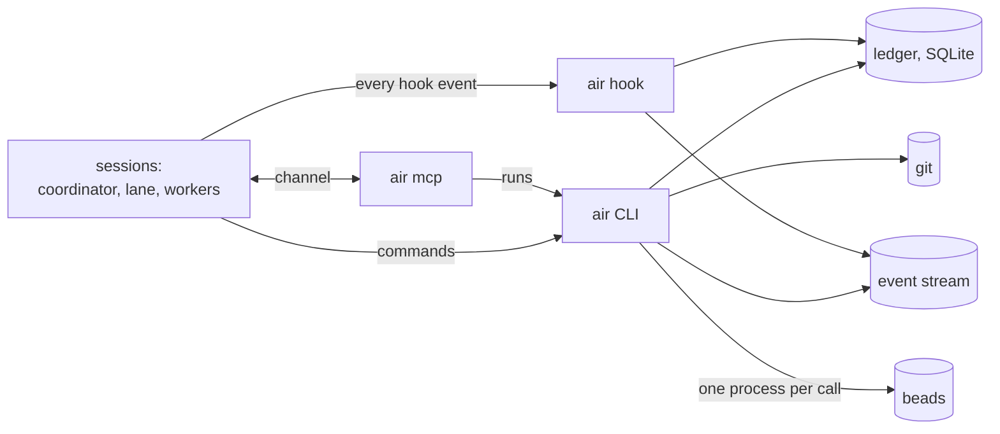
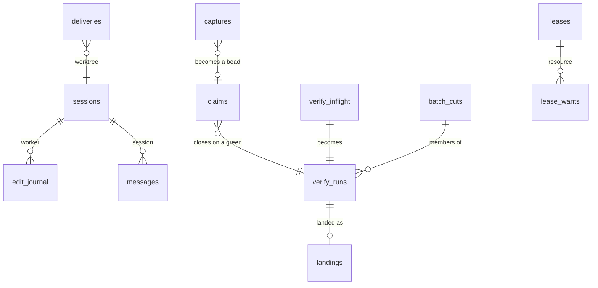
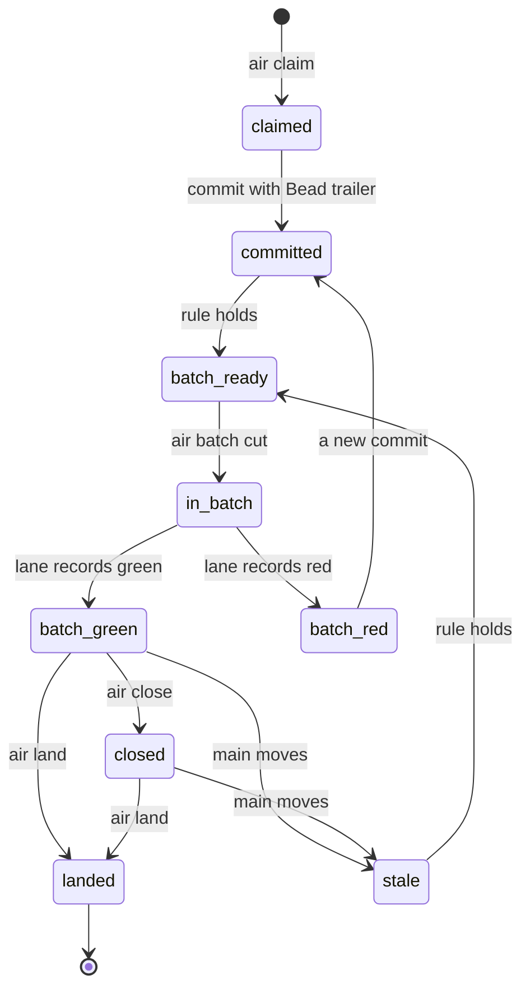
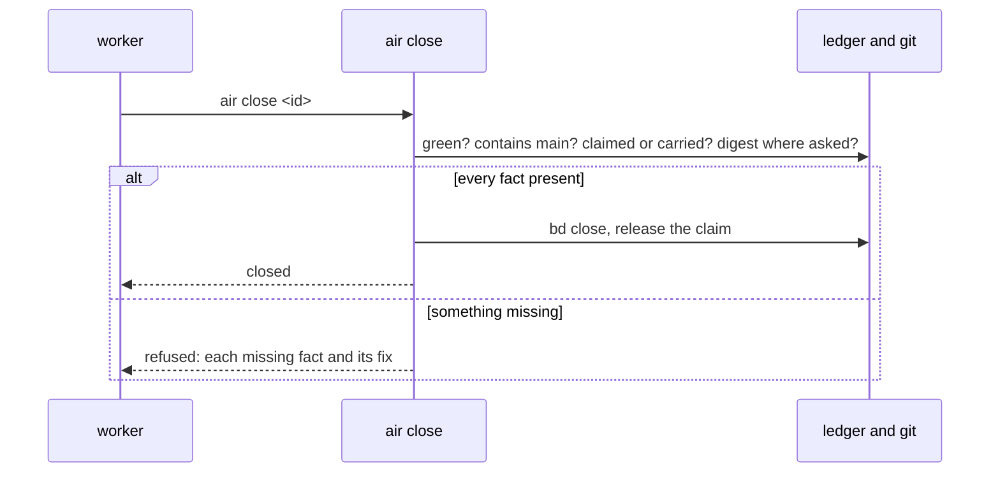
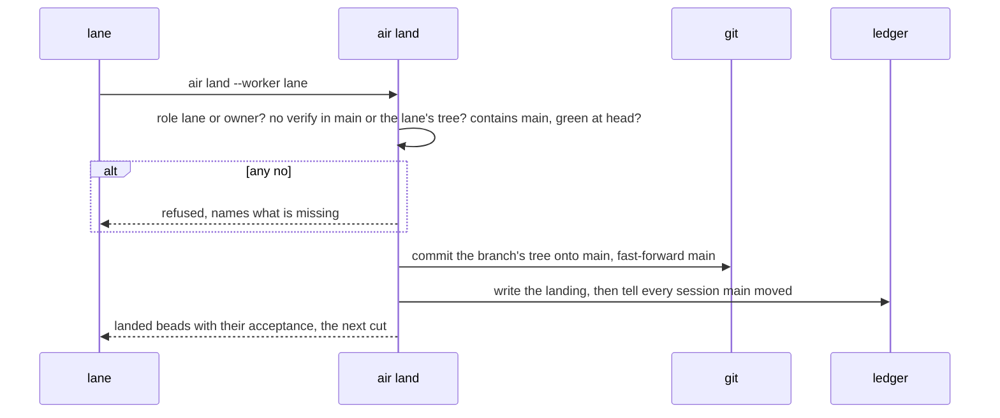
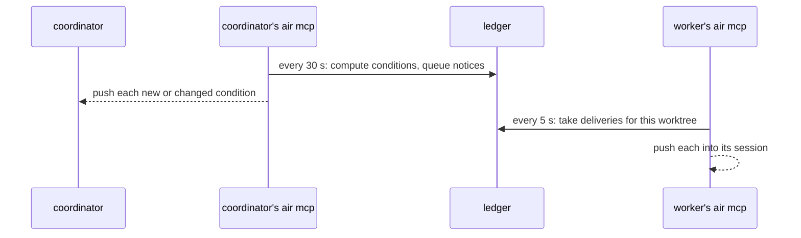
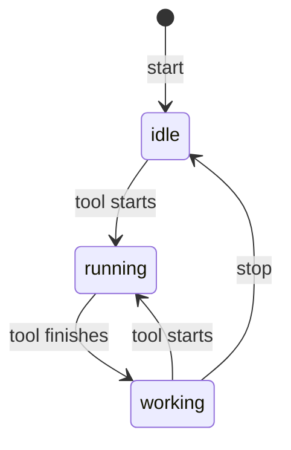

# Air design

Air is a single Rust binary that lets a few Claude Code agents work on one repository at the
same time, each in its own git worktree. It records the facts the agents would otherwise relay
from memory: which commit passed verification, who is editing which file, who holds which
task, and who holds a shared resource. On every close it checks the gate: a bead does not close
without a recorded green that contains main and every commit naming the bead.

This document describes main at `4f708fe` on 2026-09-28: version 0.4.10 (the last release row),
with 34 notices waiting for the next release. Every number below was re-derived from that tree
the same day. What was removed, and why, is in `docs/solved-issues.md` and `CHANGELOG.md`; this
document describes only what exists.

## 1. Context and goals

A fleet is five sessions: three workers, a verification lane and the coordinator, each in its
own worktree on its own branch, sharing one task store, beads (`bd`), and one main branch.
Nobody works in the main checkout. Without a shared record, agents relay facts from memory and
the relays drift; most of Air's recorded incidents trace to that. Air keeps those facts where
every session can read them, fast enough to answer inside an editor hook, and every session is
a terminal the owner can watch and type into. Air does not choose or split work, review code, or
verify on its own (it runs the repository's command and records the result), and it never
pushes, deploys or publishes.

## 2. Overview



Sessions are ordinary interactive Claude Code processes that Air starts with a role, a deny list
and a few environment variables. They reach Air by running `air` commands, through `air hook`,
which Claude Code calls on every tool call and lifecycle event, and through `air mcp`, attached
to every session Air starts as a channel that pushes conditions and messages into it. All three
are one binary writing two stores in the main checkout: the ledger for current state and the
event stream for history. Air reads git and beads through their own commands and records only
what those two cannot rebuild.

## 3. Components

The workspace has four crates. Line counts are `.rs` lines on 2026-09-28.

| Crate | Lines | What it does |
|---|---|---|
| ledger | 3,968 | The SQLite schema (v26), one row type per table, and the event writer. No network, no beads. |
| hooks | 1,313 | Hook input and output types, the close gate, the edit journal, and the stop nudge. The gate is a pure function of a set of facts. |
| bd | 652 | A wrapper over the beads CLI (`bd --json`): ready, show, claim, list, comment, close, dependencies, reclaim. It counts time spent waiting on beads. |
| cli | 53,521 | Every command, the hook entry point, the channel server, the launchers, install and init, status and its conditions, landing, audit, the lifecycle model, and the self-test (13,875 lines, 165 probes). |

The ledger is one SQLite file in WAL mode under `.air` in the main checkout, shared by every
worktree; a row stays until what it describes stops being true. The event stream gets one line
per command and per hook call: what Air was asked, what it decided, why, and what it looked at.
The hook must finish inside the installer's five second timeout and fails open: an error or
panic lets the tool call proceed and is written to the event stream. It never calls beads,
except that the stop nudge confirms its cached ready list.

The channel server is a synchronous JSON-RPC server over standard input, one per session,
started in the session's directory, so it knows its worktree. In the coordinator's and the
owner's session it computes the attention conditions every 30 seconds and pushes each that is
new, changed or escalating. In every launched session (`AIR_CHANNEL=1`) it pushes the deliveries
addressed to its worktree every 5 seconds and marks them delivered.

The launchers make `.claude/worktrees/<name>` on branch `worktree-<name>`, copy in what
`.worktreeinclude` lists, and start Claude Code there with the role prose, deny list and
environment, in the tmux session `<project>-<name>`, which is also the name `SendMessage`
addresses. The project is `project` in `.claude/air.json`, else the beads prefix, else the
directory name. A tmux name taken in another directory is refused; in the same one it attaches.
Claude Code still asks two start-up questions Air cannot answer (folder trust, and the
development-channels warning), and the coordinator launcher names both.

### 3.1 Roles and permissions

Every permission comes from `AIR_ROLE`, which only the launchers set to `worker`, `lane` or
`coordinator`. A shell Air did not start is the owner, who may do anything; an unknown value
counts as a worker. The directory and the repository path never grant anything.

Claude Code's deny list, passed by the launcher, keeps workers from `air land`, `git push`,
every beads write (reads and `bd comment` stay), `claude`, the launchers, `air fleet`, the
worktree tools and the question prompt; Air refuses `air land` and `air reclaim` again by role.
The lane is a worker with `air land` allowed, plus allow rules on its own command line for its
bare loop commands (`air land`, `air batch cut`, `air record`, `air status`, `git merge`, `git
reset --hard main`) so auto mode's classifier does not refuse them. The coordinator is denied
`git push` and the question prompt, plus `coordinator_deny`; the owner is reached through
`air capture`.

## 4. Interfaces

### 4.1 Commands

Any session may run these.

| Command | What it does |
|---|---|
| air record | Runs a check and records worker, commit, tree, exit, duration, output size, dirty flag and command. Kinds: verify, precheck, docs-check, fitness; a precheck never reads as a verify green. It refuses a backgrounded command. A signal kills the run as no verdict: SIGINT reaches the check, and on SIGTERM or SIGHUP Air stops it and records it as interrupted. A red keeps the tail of its output in `.air/logs/`. At a batch head it tells each member the result and prints the lane's next step. |
| air handover | Says what the close gate would decide for this worktree now, each missing fact with its fix, and on a pass the `air close` that would go through. |
| air close | Closes beads in one beads process and releases their claims. For a worker or the lane it runs the close gate on each bead first, whatever `AIR_ENFORCE` says, and closes nothing if one fails. It refuses an id with whitespace, and names an id beads does not have. |
| air claim | The only claim path: the ledger first, then beads, then the ledger row. It refuses while the fleet is stopped, and refuses a bead that is held, `owner`-labelled, an epic, closed, assigned elsewhere, or blocked by an open `blocks` dependency, naming the reason. A beads timeout is followed by a re-read, never a second claim. |
| air release | Returns the caller's own bead to open. It never reopens a closed bead. |
| air capture | One item, or a whole file, into the coordinator's inbox. It never blocks. |
| air holdings | Who has edits in which files, across worktrees. A recorded edit ends once its file is clean in the holder's worktree and unchanged on its branch against main. |
| air lease | Takes, releases or reports a named shared resource. `air lease needs "<cmd>"` says which lease a command needs under `leases` in `.claude/air.json`. |
| air status | The one screen: sessions, claims, greens, overlapping edits, inbox, batch-ready and in-batch branches, checks running, what else runs in each tree, a warning for a launched session running in the main checkout, loop times, and whether the install is out of date. Only a person's `air status` and `air land` run `lsof`; the channel poll reads their last reading while it is under 30 s old. |
| air batch cut | The lane's cut; see §6. It checks every batch-ready branch against main and each earlier member with `git merge-tree` (git 2.38+), drops and names a conflict, resets the lane's branch to main, and merges the rest. It refuses in the main checkout, on uncommitted changes, while the fleet is stopped, and while the lane's head is a green batch that could still land. A cut that stops part way records why and who holds any git lock. |
| air doctor | The ledger's path, size, schema and row counts, whether beads is the pinned version, and beads' mode. |
| air bd-server | `up` starts the project's Dolt server when its port does not answer, as a background process in its own process group (pid in `.air/dolt/server.pid`), and waits up to 10 s; `status` reports. Both count it up only when the process on the port serves this project's `.air/dolt/data`. |
| air audit | Per mechanism: how often it fired, over what, when last, and its removal condition; per timing budget its p50, p90, p99 and maximum beside the budget. Facts, not verdicts. |
| air selftest | A red and a green probe for every check (165); `--prove` runs each probe's declared mutation. |
| air gc | Reports what a retention period would remove from `.air/events` and removes it only with `--apply`. |

The coordinator, the lane or the owner run these. The deny list keeps workers from `air land`,
the launchers and `air fleet`; Air refuses `air land` to every launched role but the lane, and
`air reclaim` to workers.

| Command | What it does |
|---|---|
| air inbox, air triage | Lists open captures; resolves one by linking the filed bead (checked against beads) or dropping it with a reason. |
| air land | The lane's landing; see §6.3. It lists each landed bead with its acceptance text, tells every other session that main moved, closes each epic beads reports with all children closed, and prints the batch-ready set and the next command. |
| air reclaim | Takes back a gone worker's bead with `bd reclaim`, once beads' five-minute claim lease has run out; never `--force`. |
| air worker, air lane, air coordinator | Start a session (or `--print` its command). `air coordinator` first asks whether to start the fleet. `air worker` refuses while install's output is uncommitted. |
| air fleet up | Starts the Dolt server if it is down, the lane, and as many workers as `workers` says (three by default), leaving running sessions alone. |
| air fleet stop, air fleet resume | Coordinator and owner only. Stop records who and why and tells every session; while it holds, `air claim`, `air batch cut` and `air land` refuse, the ready fan-out and the stop nudge are silent, and `air status` leads with it. Nothing is killed. |
| air install | Adds the hooks and the channel server to the settings, writes `.air/roles.md` and the `air-*` skills, prints every notice the repository has not had, and writes only with `--write`. It refuses a downgrade, an unignored `.air`, or a different `air` on the path; `--pin` copies the binary to `.air/bin/air`. |
| air init | Sets up a new repository: git, beads in server mode on a free port, the ignore file, `.claude/air.json`, a verify command it finds or a failing placeholder, then install. |

Claude Code starts `air mcp` and `air hook`. The Makefile runs the hidden `release-check` and
`adopter-check`.

Every event line's command and decision is a constant in `cmd/decisions.rs`, and each registry
row in `cmd/mechanisms.rs` names the lines or budgets it counts, the failure it prevents and its
removal condition. A self-test probe fails when a decision or budget has no row.

### 4.2 Channel tools, resources and conditions

The channel server lists ten tools (status, attention, holdings, handover, claim, release,
capture, inbox, triage, close) and five resources (status, attention, inbox, holdings, leases),
all running the CLI with `--json`, and answers three lease tools it does not list. The
coordinator's channel pushes ten conditions, computed by `air status`, each keyed by its subject
and pushed when new, changed or escalating; its age counts from when the channel first saw it.

| Condition | Meaning |
|---|---|
| idle with claim | A worker holds a bead and has been idle past the threshold; the text gives the pid's liveness. |
| silent with claim | A worker holds a bead and its session has written nothing for a while. |
| gone with claim | A worker holds a bead and its process has gone. |
| idle without claim | A worker is idle with no claim while claimable beads are ready and nothing of its own runs in its tree. |
| handover not green | Someone tried to close a bead without the green the gate wants. |
| landable | A branch other than the lane's is green and contains main, and no lane session is alive. |
| closed not landed | A bead is closed and its commits are only on one worktree's branch. |
| rewound and carried | A merge that was rewound off main is still carried by a branch. History only. |
| lease held by dead session | A shared resource's holder has gone. |
| lease stale | A shared resource's holder has not refreshed it in time. |

### 4.3 Hook events

`air install` registers the hook on eleven Claude Code events, each with a five second timeout.
Every call, including the silent ones, writes one event line.

| Event | What happens |
|---|---|
| SessionStart, SessionEnd | The session's row is created idle, or ended. A start from compaction keeps the state it found. |
| PreToolUse | For an edit, a warning if another worker's recorded edit is on the file. A command the repository says needs a lease is refused to a worker or the lane not holding it (redirections removed before matching). A `SendMessage` is recorded with its content. |
| PostToolUse | The edited file goes in the edit journal and the session is marked working. |
| PostToolUseFailure, PermissionRequest, PermissionDenied, Notification, StopFailure | The session's state is updated. A stop failure, a quota notification, or a permission or idle prompt is the session's sticky fact, shown until the session's next event of its own. |
| Stop | The session is marked idle. A worker is nudged with ready beads it has confirmed when it holds no claim or, under a lane, when every claim it holds is batch-ready; the same set is named once. The lane and the coordinator are never nudged. |
| SubagentStop, and any hook inside a subagent | Only an event line; a subagent never changes its parent's state or clock. |

### 4.4 Files, configuration and environment

| Path | Purpose |
|---|---|
| `.air/ledger.db`, `.air/events/` | The ledger and the event stream; git must ignore `.air`. |
| `.air/logs/` | The kept tail (64 KiB) of every red or killed run; never pruned by Air. |
| `.air/roles.md`, `.air/installed.json` | The role prose appended to every session's prompt; the version and notices installed. |
| `.air/ready.json`, `.air/tasks/` | The cached ready list for the stop nudge; a worker's first task. |
| `.air/journal/` | One session journal per file, from any worktree, unless `journal_dir` names a tracked one. Nothing reads it. |
| `.air/digests/` | Digests the close gate reads when `"digests": true`. |
| `.air/dolt/` | The Dolt server's data, log and pid, when beads runs in server mode. |
| `.claude/worktrees/<name>` | One worktree per session. |
| `.claude/settings.json`, `.mcp.json` | The hook entries and the channel server entry, merged in by install. |
| `.worktreeinclude` | Ignored files copied into new worktrees. |
| `changelog.d/<bead>.md` | One changelog fragment per bead; `make changelog` folds them into `CHANGELOG.md`. |

`.claude/air.json` holds the repository's settings: `project`; `worker_deny` and
`coordinator_deny`; `leases`; `verify_lane` (true here: the lane batches and workers run no
verify of their own); `precheck`; `verify_key` (`tree` here, so a green stands for any commit
with the same tree); `digests` or `digest_dir`; `journal_dir`; `workers`; `metis`; and
`adopters`.

The launchers set `AIR_ROLE`, `BEADS_ACTOR`, `AIR_PROJECT`, `AIR_CHANNEL=1`,
`BEADS_DOLT_AUTO_START=0`, and for workers and the lane `AIR_ENFORCE=1`, which makes the gate
refuse rather than advise. `air worker worker-9 --print` shows a whole launch, including
`--append-system-prompt-file .air/roles.md`, `--name ai_runner-worker-9`, the development
channel and `--disallowed-tools`. Other variables move where Air finds its tools and change
its timeouts (`AIR_BD_TIMEOUT_MS`).

## 5. Data



| Table | Holds | Written by |
|---|---|---|
| verify_runs | One row per recorded check: commit, tree, exit, command, duration, dirty flag, kept log, the main it ran over, batch members. | record, land |
| verify_inflight | The check running now and its process. | record |
| batch_cuts | The members a cut merged, keyed by lane and head. | batch cut |
| claims | Who holds which bead, the files declared, and when and why it let go. | claim, release, close, reclaim |
| sessions | One row per worker name: role, state, sticky fact, and pid with start time; alive only when that pid runs with that start time. | the hook |
| edit_journal | Which worker touched which file, and when; deleted when the edit ends. | the hook, holdings, land |
| landings | Each landing: result, beads, the landing commit. | land |
| captures | Inbox items and their triage. | capture, triage |
| leases, lease_wants | Who holds each shared resource, and who waits for it. | lease, the hook |
| deliveries | Every message Air addressed to a worktree: kind, subject, text, queued and delivered times; unique per worktree, kind and subject. | the commands that notice a change; the recipient's channel |
| messages | Every `SendMessage`, with its content. | the hook |
| conditions, hook_emissions, bd_cache | Attention conditions with first and cleared times, what a hook last said per session, and small cached answers (ready counts, the process reading). | status, the hook |
| fleet_stop | One row while the fleet is stopped. | fleet stop, resume |

Ledger rows do not expire (`air doctor` on 2026-09-28: 498 verify runs, 258 claims, 175
landings); event files go only with `air gc --apply`, never while the ledger points at them.

## 6. Flows

### The bead and branch lifecycle

Every flow below is a path through this table. The states are facts Air reads at the moment,
not fields it stores, and each transition is decided by the pure function in the last column.



| State | Event | Next state | Decided by |
|---|---|---|---|
| claimed | commit carrying `Bead: <id>` | committed | `attribution::attributed_in_range` |
| committed | the rule holds | batch-ready: names a bead held or closed in `main..head`, not landable alone, not in a running batch, not a lone red member, not dropped at this head, precheck green where declared | `status::batch_ready_rule` |
| batch-ready | `air batch cut` | in-batch: the lane's branch is main plus every batch-ready head | `batch_cut::run`, refusing while the lane's head could still land (`batch_cut::land_first`) and on the guards §4.1 lists: the main checkout, uncommitted changes, a stopped fleet, a git without `merge-tree --write-tree` |
| in-batch | lane records green | batch-green | `record::run` |
| in-batch | lane records red | batch-red: nothing lands; a lone member is held out | `status::red_alone` |
| batch-red | a new commit | committed | `status::red_alone` no longer matches |
| batch-green | `air close` | closed | `air_hooks::handover_verdict`, with `batch::cover` |
| batch-green | `air land --worker lane` | landed | `land::check`: green at head, head contains main |
| batch-green | main moves first | stale: cannot land, and the next cut resets past it | `batch_cut::land_first` |
| closed | main moves before the landing | stale and closed: batch-ready again, a closed bead counts | `status::batch_ready_rule` |
| landed | `air close` | closed: the work is read from git as in main | `batch::in_main` |
| claimed | `air release` | open again | `claim::release` |
| any | fleet stop | unchanged: claim, cut and land refuse until resume | `fleet::stopped` |

No cell lacks a way out. The model test in `crates/cli/src/cmd/lifecycle.rs` calls five of
these functions, `batch_ready_rule`, `red_alone`, `land_first`, `cover` and `handover_verdict`,
through every order of commit, merge, close, cut, verify, land and a move of main for two
workers and a lane (86,895 states in 3 s). It models the rest itself: containment as set
inclusion in place of `in_main`, and a landing as `land::check`'s two conditions. It fails if any
reachable state can no longer land and close every bead, and it fails on the code before the
fixes of 2026-09-28.

### 6.1 Claiming a bead

```mermaid
sequenceDiagram
  participant W as worker
  participant A as air claim
  participant L as ledger
  participant B as beads
  W->>A: claim a bead
  A->>L: held by another worker?
  A->>B: show it: owner-labelled, epic, closed, assigned, blocked?
  alt any of those
    A-->>W: refused, says which
  end
  A->>B: claim it (atomic); on a timeout, show it again
  A->>L: write the claim
  A-->>W: claimed
```

The ledger is asked first because it is local; beads decides races because its claim is the
only atomic write, and a timeout is followed by a re-read, never a second claim.

### 6.2 Closing a bead



A green is a successful run at the exact commit, or at any commit with the same tree when
`verify_key` is `tree`. A bead is also covered, whatever its head carries after it, when a
recorded green contains every commit whose `Bead:` trailer names it and the main that run was
recorded over (`batch::cover`, over every green since the bead's oldest commit), or when main
contains all those commits (`batch::in_main`); under a lane that is how a worker closes on the
lane's green. A head main is ahead of is refused as behind main unless main contains it, the
bead is covered, or, under a lane, no green is at the head yet. A refusal names a red recorded
at the head with its kept output, a missing precheck, or a missing trailer. A bead no commit
names passes on the head check alone, when a green stands at the worker's head.

### 6.3 Landing



Main moves only by fast-forward onto a commit whose tree has a green, so nothing is re-verified
or rolled back. The landing records the beads its commits name by trailer; a range naming none
lands only if every commit is a journal entry or the coordinator's. The row is written after
main moves, and the notice after the row. Epics whose children are all closed are closed. The
worker closes its own bead, before or after. `--despite-inflight` lands over a running verify
and records it.

### 6.4 A hook call

Each call reads Claude Code's event from standard input, does what §4.3 lists for it, writes one
event line, and answers allow, or refuses only a lease command. The target is a tenth of a
second, so anything slow lives in the CLI. A hook Claude Code kills at five seconds writes
nothing, so `air audit` counts hook events with no follow-up.

### 6.5 The channel and notices



Claude Code hands channel events that arrive during a turn over on the next turn. A delivery is
queued by whatever notices the change and is unique per worktree, kind and subject, so nothing
is repeated unchanged.

| Notice | Queued by | To |
|---|---|---|
| beads are ready | the coordinator's tick, when the claimable set gains a bead or a worker is newly without a claim | live workers holding no claim |
| batch-ready | the tick, once per branch head | the lane |
| batch green, batch red | `air record` at a batch head | each member; a green names only beads it covers that the member still holds |
| dropped from batch | `air batch cut` | the dropped branch's worker, with the other side and the paths |
| main moved | `air land` | every session but the lane and the one that landed |
| capture from | `air capture` | the coordinator |
| the ready queue is empty | the tick, once per emptying | the coordinator |
| bd server was down | the tick's check of the Dolt port | the coordinator, once per outage |
| lease is free | `air lease release` or break | each worker waiting, oldest first |
| fleet stop, fleet resumed | `air fleet` | every session |

Every notice states what is observed and, where one exists, the command that acts on it.
`air status` prints two loop times for the last 24 hours, batch-ready to its verify and batch
green to close. The coordinator's 5-minute heartbeat is the backstop for a missed push.

### 6.6 Session states



`air status` adds gone, for a process that disappeared without ending, and no session. A sticky
fact (stopped for quota, waiting for the person) shows until the session's next event.

### 6.7 Timing budgets

Every wait records its duration and whether it hit its limit. Each budget in `cmd/budgets.rs`
names the measurement its number came from, `air audit` prints its p50, p90, p99 and maximum
beside it, and a hit is reported as a fact about load. The numbers below are unchanged pending
the owner's ruling on air-1cdr. A beads call gets 60 s plus 5 s
per bead named, from one function every call uses, and fails closed naming `AIR_BD_TIMEOUT_MS`.
The status tick gets four times beads' median (2 to 8 s) and falls back to cached counts; the
stop nudge gets 3 s. Each MCP tool runs its command in its own process group, one beads limit
above what the command can spend, capped 10 s under Claude Code's `MCP_TOOL_TIMEOUT`; the read
tools get 20 s. On the hook path git gets 1.5 s, the SQLite lock 1 s, and the hook 5 s, all
failing open.

## 7. Guarantees and failure model

| Always true | Enforced by | A violation shows up as |
|---|---|---|
| A bead closes only with a green containing main and every commit naming it, or with its work in main. | The close gate, enforced for workers and the lane. | A handover not green condition. |
| Main moves only forward, onto a tree with a green. | `air land`. | A commit on main with no run. |
| One worker holds a claim at a time. | The ledger check, then beads' atomic claim. | Two open claims for one bead. |
| A lease command runs only while its lease is held. | The hook, refusing for workers and advising the coordinator. | A lease refuse event. |
| Permissions come from `AIR_ROLE`, never from the directory. | Every role check. | A self-test probe going red. |
| Workers cannot push, file beads, land, start sessions or ask the owner directly. | The deny list, backed by role checks. | A permission denied event. |
| Every command and hook call leaves one event line. | Each command's logging, the hook's fail-open path. | A hook event with no follow-up. |
| A check that finds nothing says what it looked at. | A rule per check, probed by the self-test. | A green with nothing examined. |
| Every reachable lifecycle state can still land and close every bead. | `lifecycle.rs`, in `make verify`. | The model test failing. |
| Adopting repositories are told every change that affects them. | The notice list, one release per round, `air release-check`. | `make release` refusing. |

The hook fails open, because it must never block the editor. A beads timeout during a claim
leaves the state unknown and the bead is read again; a killed verify is no verdict. When the
Dolt server is down every beads command fails; the launchers start it first and the
coordinator's tick restarts it and says so, never over a data directory without the project's
database. An unknown process reading counts as nothing running. Everything else fails closed
and names its fix: landing while a verify runs in the main checkout or the lane's tree unless
overridden (a worker's own verify never blocks it), the wrong role landing or
closing, a repository path outside the project, and install over a newer version, an unignored
`.air` or a different binary.

## 8. Enforcement and judgement

Air enforces who may run what, atomic claims, one holder per shared resource, the close gate,
an honest record of every verify, who edited what, and main moving only onto a verified tree.
The agents decide the rest: what a capture becomes, which bead to take, whether a diff is good
or a verify enough, and what to do about a condition; the owner decides `owner` beads. Left out
on purpose: a cap on work in progress, stored epic phases, automatic retries of a red, headless
workers, claims inferred by watching beads, Gas Town's convoys and merge slots, and automatic
prioritisation; `air next`, `air peer` and merge advice were specified and never needed.

### 8.1 Standing rulings

The owner's rulings in force, one line each, dated when made or last changed.

| Rule | Date | Carried by |
|---|---|---|
| Closing needs a green containing main and the bead's commits; a digest only where configured. | 2026-09-25 | the close gate, `AIR_ENFORCE=1` |
| A green is keyed by commit and counts for any worker; by tree only where declared. | 2026-09-05 | `verify_key` |
| A backgrounded verify is refused; a dirty tree, a changed command and the counts at a commit with several runs are stated beside the exit. | 2026-09-28 | `air record` |
| Landing is refused while a verify runs in the main checkout or the lane's tree, never for a worker's own; the override is recorded. | 2026-09-28 | `land::at_risk`, `air land --despite-inflight` |
| Nothing reopens a closed bead. | 2026-08-21 | claim, release, reclaim |
| Air gets out of the way and states facts as soon as they are true; a trial workaround is fixed only where Air caused it, by removing or correcting that part. | 2026-09-26 | §9.1 |
| Every message Air sends states what it observed and the fixing command, never an opinion. | 2026-09-28 | every notice and refusal |
| Everything Air says is keyed by kind and subject and said when new, changed or escalating, never again unchanged. | 2026-09-28 | `deliveries`, `select_new_at` in `mcp.rs` |
| A worker idle without a claim is a condition; queue depth is only measured. | 2026-08-22 | `idle-without-claim` |
| This repository runs a verification lane; workers run no verify of their own. | 2026-09-28 | `verify_lane` |
| The lane's loop commands run bare, with no pipe or redirect, under allow rules on its command line. | 2026-09-28 | `air lane` |
| Taking back a bead never forces beads; it waits for the claim lease. | 2026-09-26 | `air reclaim` |
| A new project's beads runs in server mode on one Dolt server per project, a plain background process Air starts and keeps up; an embedded project stays embedded. | 2026-09-28 | `air init`, `air bd-server` |
| Each budget names the measurement its number came from, and `air audit` prints its p50 and maximum beside it; a hit is a fact. The numbers are unchanged pending air-1cdr. | 2026-09-28 | `cmd/budgets.rs`, `air audit` |
| A worker cannot claim an `owner` bead; `owner` is authority and `human` means presence. | 2026-09-05 | `OWNER_LABEL` |
| A default is closed only where a wrong denial is loud; a message is never refused. | 2026-08-22 | roles.md |
| The ledger keeps only what git and beads cannot rebuild, and nothing expires by time. | 2026-08-17 | `crates/ledger` |
| Each hook call appends one event line; every `SendMessage` is recorded; every mechanism has a removal condition. | 2026-09-05 | `air hook`, `messages`, `mechanisms.rs` |
| Every session is an interactive terminal the owner can watch and type into. | 2026-09-06 | the launchers |
| Workers capture; they never file, claim through beads, push, land or launch. The coordinator may commit and launch, not push or land. Denies ride launcher flags. | 2026-09-14 | `WORKER_DENY`, `COORDINATOR_DENY` |
| Air makes each session's worktree; the verification lane is a role and the only one that lands. | 2026-09-14 | `air lane`, `air land` |
| The merge-queue protocol is Air's and ships in `.air/roles.md`; a repository keeps only its commands, setup and resources. | 2026-09-25 | `.air/roles.md` |
| A worker closes its own bead with proof through `air close`; there is no review status, and beads writes are denied to workers and the lane. | 2026-09-26 | `close.rs`, `WORKER_DENY` |
| Proof is a command's output, a `file:line` or a test; what only the owner can do becomes a successor bead. | 2026-08-22 | roles.md |
| Landing attributes beads by `Bead:` trailers; workers pull work and nobody assigns it. | 2026-08-22 | `air land`, `air claim` |
| beads is the task store, pinned at 1.3.0; Air wraps it and never watches it; beads are created with `--validate`. | 2026-09-26 | `air doctor` |
| One release row per round; changelog entries are one fragment per bead. | 2026-09-28 | `air release-check`, `changelog.d/` |
| Apache 2.0; adopters are cited as "an adopter", names in `private/`. | 2026-09-06 | `air adopter-check` |
| Do less and measure before enforcing; a probe counts once seen failing; a zero is evidence only if the subject occurred; no Claude memory; one design doc. | 2026-09-25 | CLAUDE.md, `do-less`, `project-diligence` |
| Green is `make verify`; tests stay fast and hold no wall-clock bar except against a stall they inject. | 2026-09-28 | Makefile |

## 9. Operations

Install Air with cargo from this repository, then `air init` in a new repository or `air
install` in one that uses beads; both write only when told to. Start the coordinator with `air
coordinator`; a yes, or `air fleet up`, starts the lane and the workers. `air status` is the
screen to watch. Worktrees isolate branches, not the machine: a repository with heavy builds
gives each worktree its own `CARGO_TARGET_DIR` and a share of `CARGO_BUILD_JOBS`.

`make verify` checks formatting, runs clippy, the tests, the adopter check, and the self-test on
the binary it built. A release appends a row to `install::RELEASES`, sets `Cargo.toml`'s
version, and `make release` refuses a dirty tree, a branch other than main or leftover changelog
fragments, then runs `air release-check`, `make verify` and `make adoption-check` (which adopts
a copy of `examples/minimal`) and tags. Air writes three tracked files in a repository and
ignores the rest; it runs git, beads, tmux, ps, lsof, Claude Code and the verify command, and
contains no network code.

### 9.1 The live trial

Every release is tried on a real fleet before it is tagged. `make trial` builds the binary,
adopts a scratch copy of `examples/minimal` with it pinned and `"verify_lane": true`, and copies
`scripts/trial/request.md` in. The coordinator, started with `.air/bin/air coordinator --fleet`,
reads the request, which sets up every scenario. When every bead is closed it writes
`.air/trial-report.md`, and an observer checks it against the events, git and beads and adds
the counts from `scripts/trial/count.py`. Defects are filed as beads, traced to their cause, and
not fixed during the trial. The release is tagged only if every scenario ends as expected.

| Scenario | Set up | Expected |
|---|---|---|
| Happy path | Three unrelated beads | Batches land, every bead closes with proof, `make verify` passes on main |
| Conflict | Two beads changing the same line, two workers | The cut drops the later-ready branch naming the file; it lands in a later batch |
| Red batch | A bead that breaks a test | The batch is reported red by member and nothing lands |
| Early close | A worker closes before the lane's green | Refused, naming what is missing |
| Lease | A lease on a command, run by two workers | The second is refused until the first releases |
| Behind main | A branch still waiting when another batch lands | It stays ready and lands without its worker merging main |
| Landing by role | The coordinator runs `air land` | Refused; only the lane lands |
| Precheck | `"precheck": true`, a hand-over without one | Not ready for the lane until `air record precheck` passes |

## 10. TODO

One row per item; a row is deleted when its work lands.

| Item | Added | Detail |
|---|---|---|
| Describe the fleet everywhere as three workers, a lane and the coordinator; CLAUDE.md still says "the workers and the coordinator". | 2026-09-14 | air-rr98 |
| Record the failing step on a red run; `failing_step` is written only for an interrupted run. | 2026-09-14 | `cmd/record.rs` |
| Red-batch policy: drop the member the failing step names, else halve; one recorded re-run for a suspected flake. Owner ruling open. | 2026-09-14 | recommended: drop by step |
| A verify whose tree changed between start and exit records a green for a tree that never existed; flag it like a dirty start. | 2026-09-14 | `cmd/record.rs` |
| Does the coordinator keep `air close`? Recommended yes, counted: it recovers a gone worker's bead. Owner ruling open. | 2026-09-14 | `cmd/close.rs` |
| `air close` passes a bead no commit names when a green stands at the worker's head. Owner ruling open. | 2026-09-28 | air-k52n comment |
| `air gc` does not collect `.air/logs/`, which grows by up to 64 KiB per red run. | 2026-09-28 | air-06k7 |
| The trial request still expects an edit outside the worktree to be refused, which nothing refuses now. | 2026-09-28 | `scripts/trial/request.md` |
| The next trial shows both loop times under a minute plus the verify, and a fan-out and a fleet stop reaching exactly their sessions. | 2026-09-26 | air-1vri |
| Audit every command and channel tool: purpose, incident, overlap, keep or drop; use an adopter's counts. | 2026-09-14 | |
| List or remove the three lease tools the channel answers without listing. | 2026-09-25 | `cmd/mcp.rs` |
| Cut source comments to responsibility, invariants and contract, crate by crate. | 2026-09-25 | |
| The do-less questions per mechanism, the failure direction of each text parse, a pass over the roles text, and the multi-agent question once traffic is measured. | 2026-08-29 | `do-less` |
| Whether `bd serve` is worth a daemon, and whether beads' compare-and-set lets the claims table stop being the authority. | 2026-09-25 | §11 |
| Keep the adopting guide current, and the README's quick start once the coordinator sets up the fleet on request. | 2026-09-25 | `docs/rules/adopting-air.md` |
| Turn the two findings indexes about the adopter into beads. | 2026-09-25 | `private/adopter-corpus/` |

## 11. Technology decisions

Each choice, why, and the evidence; a URL carries the date it was read.

| Decision | Why | Source |
|---|---|---|
| Rust, one binary, no async runtime; tests on in-memory SQLite and temporary git repositories, with no sleeps and no network. | Air is installed into other repositories, so it ships as a binary and a target repository never depends on its build. The hook runs on every tool call and has a tenth of a second. | CLAUDE.md "Rust", "Tests"; §6.7 |
| One SQLite file in WAL mode for current state, one NDJSON file per day for history, both in the main checkout's `.air`. No daemon. | One machine and many short-lived writers; with six writers the lock waited at most 131 ms (2026-09-06). | `crates/ledger`; §6.7 |
| beads (`bd`) is the task store, pinned at 1.3.0, called only as `bd --json` behind one trait, never from a hook. New projects run it in server mode on a Dolt server per project. | It supplies a dependency-aware ready list and an atomic claim, which Air cannot compute cheaply. 1.3.0 is the first tested release off main (2026-09-15). A beads process costs about 1.4 s (median of 751,673, 2026-09-06). | https://github.com/steveyegge/beads/blob/main/docs/recovery/accidental-1-2-1-release.md (2026-08-17); `crates/bd/src/lib.rs`; `.claude/skills/beads/references/bd-facts.md` |
| Stay on beads rather than beads_rust or a table of Air's own. | beads_rust is store-incompatible and ships no library; a table of Air's own is a work tracker to build, and the ledger records no failure caused by beads. | https://github.com/Dicklesworthstone/beads_rust (2026-09-06); https://api.github.com/repos/steveyegge/beads/releases/latest (2026-09-25) |
| Gas Town is prior art, not a runtime. | It supervises with LLM agents, costs about $100 an hour, and was seen merging over failing tests. Air took its batch-then-bisect queue and its heartbeat cross-check. | https://www.dolthub.com/blog/2026-01-15-a-day-in-gas-town/ (2026-08-17); https://github.com/steveyegge/gastown (2026-08-17) |
| Claude Code is the harness. | Deny rules hold in every permission mode; the PreToolUse hook sees a command before it runs; sessions stay interactive terminals. | https://code.claude.com/docs/en/permission-modes (2026-09-05); https://code.claude.com/docs/en/hooks.md (2026-08-17) |
| Keep Air rather than adopt an orchestrator. | Of 186 orchestrators read, eleven overlap part of Air and none refuses to close a tracked item without a recorded green containing main in a watched session; spawning and isolating sessions are commodity. | https://github.com/andyrewlee/awesome-agent-orchestrators (snapshot 2026-08-24) |
| Not adopted: the agent client protocol, Symphony's dispatcher, Vibe Kanban's executors, pueue, Codex's app server, an Air daemon. | Air drives no agent process and runs no daemon; the gate needs a hook and a bead id. | §8 |
| One git worktree per session, made by Air. | Enforced partitions beat declared ones (PaperBench: 57.2 single agent, 55.5 prompt-declared, 63.3 worktrees). Air makes the worktree so it can copy ignored files in. | https://arxiv.org/abs/2603.21489 (2026-08-21) |
| Detached tmux sessions named for the project and the role. | Every session must stay attachable; no Claude Code flag starts a session detached. | CLAUDE.md "A human is always in the loop"; `claude --help` 2.1.241 (2026-08-24) |
| One stdio MCP server per session as its channel; tools run the CLI with JSON output. | It lives and dies with its session, so there is no daemon, and the channel and the CLI cannot disagree. Agent operations stay CLI-first: MCP failures wasted 12.9% of spend against 2.2%. | `crates/cli/src/cmd/mcp.rs`; https://arxiv.org/abs/2608.08654 (2026-08-18) |
| The channel delivers Air's messages to every launched session. | A channel is the documented push into a running, even idle, session; events during a turn are queued for the next. A Stop hook with asyncRewake needs a waiting process per stop. The cost is one development-channels confirmation per session. | https://code.claude.com/docs/en/channels-reference.md, https://code.claude.com/docs/en/hooks.md (2026-09-26, Claude Code 2.1.283) |
| The lane is a merge queue: batch, one verify at a time, fast-forward onto a verified tree, a conflict back to its author, no speculation, no rebase. | Every merge queue with a slow verify batches and splits on red; on one machine the verify is the CPU, and a rebase gives every commit a new sha. | bors-ng README, https://zuul-ci.org/docs/zuul/latest/gating.html, GitHub merge queue docs (2026-09-14) |
| `git merge-tree --write-tree` for the conflict check; git 2.38 or later. | It merges without touching the index or the working tree. | https://git-scm.com/docs/git-merge-tree (2026-09-14) |
| A few sessions: three workers, a lane, a coordinator. | Returns thin beyond three or four agents; subscription usage pools across sessions. | https://arxiv.org/abs/2512.08296 (2026-08-18); https://code.claude.com/docs/en/costs.md (2026-08-17) |
| The close gate is an external recorded check, not the agent's report. | Models still claim success they did not achieve; an anti-cheating prompt lowers the rate and leaves it high (Opus 4.5, 55% to 35%). | https://assets.anthropic.com/m/64823ba7485345a7/Claude-Opus-4-5-System-Card.pdf (2026-08-18) |
| Facts and refusals over procedure prose, each mechanism with a removal condition. | Context files do not raise task success and cost over 20% more; harness pieces encoding what a model cannot do get removed on the next model. | https://arxiv.org/abs/2602.11988, https://www.anthropic.com/engineering/harness-design-long-running-apps (2026-08-21); `.claude/skills/do-less/references/evidence.md` |
| Metis is attached to the coordinator for planning; Air stores no phase. | Metis enforces only forward-only phase moves on its own documents; Air borrows its decomposition reasoning and derives an epic's state. | metis at 6745810 (2026-08-17) |

## 12. Glossary

| Term | Meaning |
|---|---|
| bead | One task in beads, the task store. |
| claim | The ledger's record that a worker holds a bead. |
| lane | The verification lane: the session that cuts, verifies and lands batches. |
| owner | The person running the fleet, and any shell Air did not start. |
| main checkout | The repository's own directory, on main, where the ledger lives. |
| green | A successful recorded verify at a commit, a tree, or a batch. |
| batch-ready, stale | States in the lifecycle table in §6. |
| landing | Moving main forward onto a verified tree. |
| capture | One item in the coordinator's inbox. |
| lease | Exclusive use of a named shared resource. |
| notice | An entry telling adopting repositories what changed in a release. |
